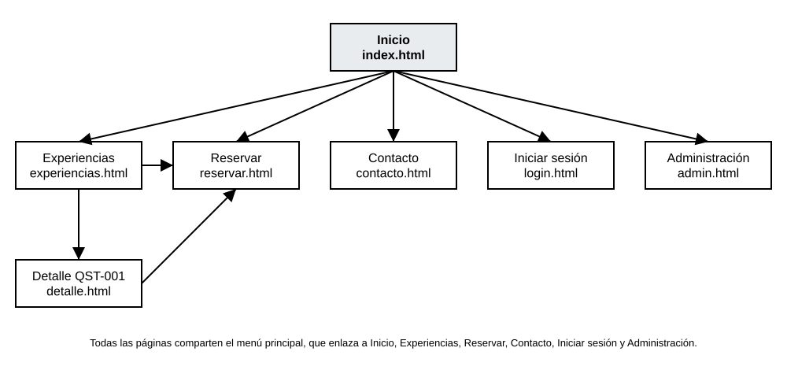

# Mapa del sitio

QuestPass CR tiene siete páginas. El menú principal está en todas ellas y enlaza a seis; la página de detalle se abre desde experiencias.

## Páginas y relaciones

- **Inicio** (`index.html`)
  - Experiencias (`experiencias.html`)
    - Detalle de QST-001 (`detalle.html`)
      - Reservar (`reservar.html`)
    - Reservar (`reservar.html`)
  - Reservar (`reservar.html`)
  - Contacto (`contacto.html`)
  - Iniciar sesión (`login.html`)
  - Administración (`admin.html`)

## Navegación

- **Menú principal**, en las siete páginas: Inicio, Experiencias, Reservar, Contacto, Iniciar sesión y Administración. El nombre QuestPass CR también enlaza al inicio.
- **Inicio**: botones a Experiencias y a Reservar, y enlaces a las mismas páginas en los pasos para reservar.
- **Experiencias**: cada tarjeta enlaza a Reservar; la tarjeta de QST-001 enlaza además al Detalle.
- **Detalle**: ruta de navegación a Inicio y Experiencias, y botón para reservar.
