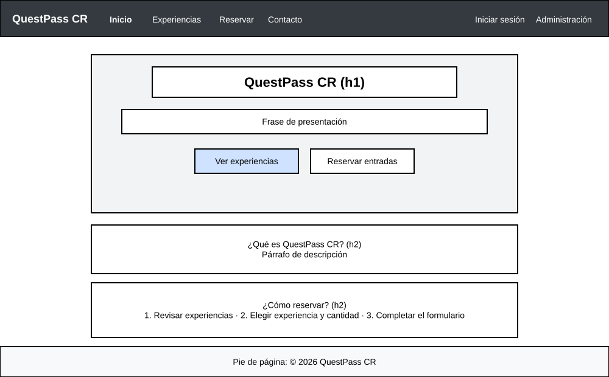
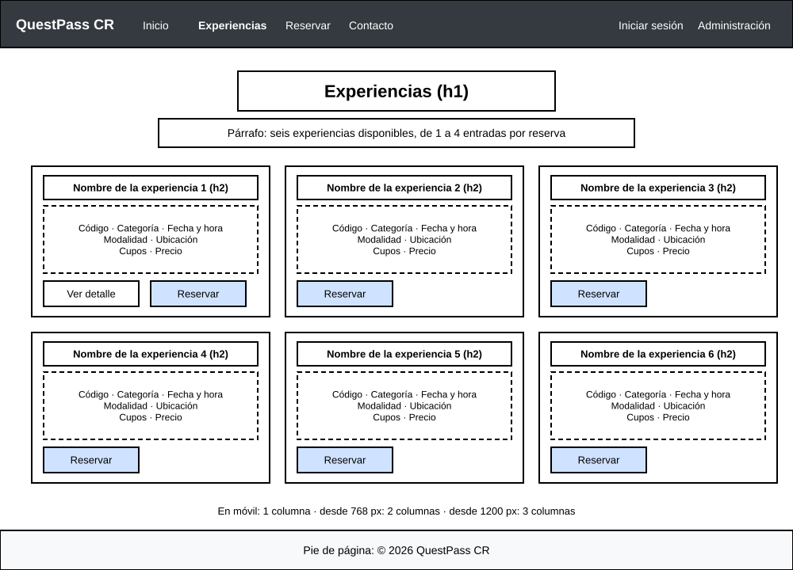
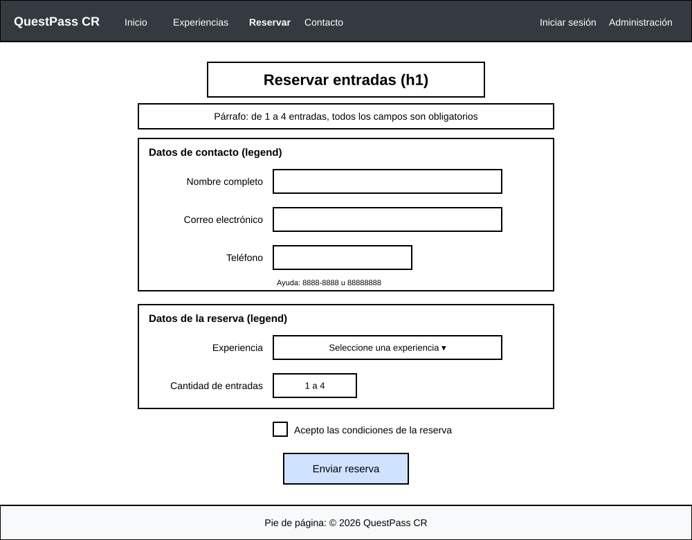
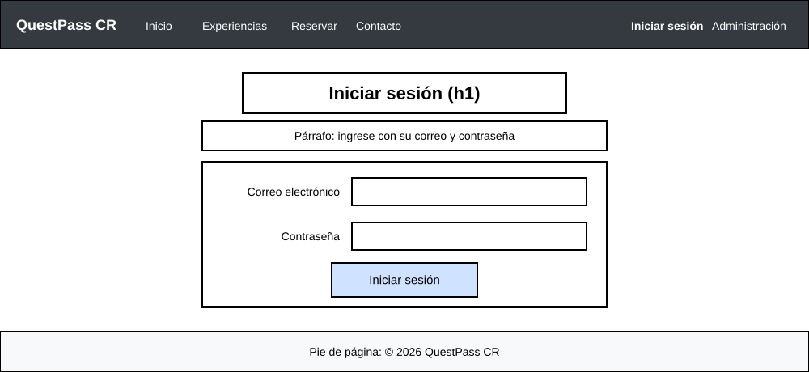
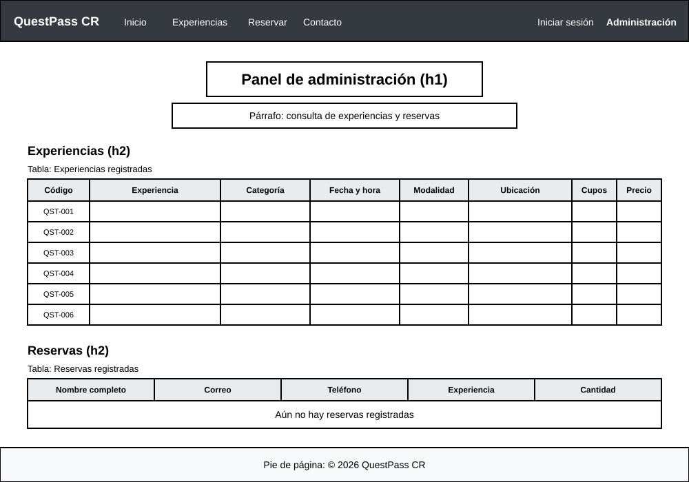

# Wireframes

Wireframes de baja fidelidad de las cinco pantallas principales, en vista de escritorio. Todas comparten el menú superior y el pie de página.

## index.html

- Menú superior con el nombre QuestPass CR y los enlaces del sitio.
- Portada con el título, una frase de presentación y los botones "Ver experiencias" y "Reservar entradas".
- Sección "¿Qué es QuestPass CR?".
- Sección "¿Cómo reservar?" con tres pasos.
- Pie de página.

## experiencias.html

- Título y párrafo introductorio.
- Seis tarjetas: una columna en móvil, dos desde 768 px y tres desde 1200 px.
- Cada tarjeta muestra el nombre, los datos de la experiencia y el botón "Reservar".
- La tarjeta de QST-001 tiene además el botón "Ver detalle".

## reservar.html

- Título y párrafo con las indicaciones.
- Formulario centrado con dos grupos:
  - Datos de contacto: nombre completo, correo electrónico y teléfono con texto de ayuda.
  - Datos de la reserva: experiencia y cantidad de entradas.
- Casilla para aceptar las condiciones.
- Botón "Enviar reserva" centrado.

## login.html

- Título y párrafo.
- Formulario angosto y centrado con correo electrónico y contraseña.
- Botón "Iniciar sesión" centrado.

## admin.html

- Título y párrafo.
- Sección "Experiencias" con una tabla de ocho columnas y las seis experiencias oficiales.
- Sección "Reservas" con una tabla de cinco columnas y el mensaje "Aún no hay reservas registradas".
